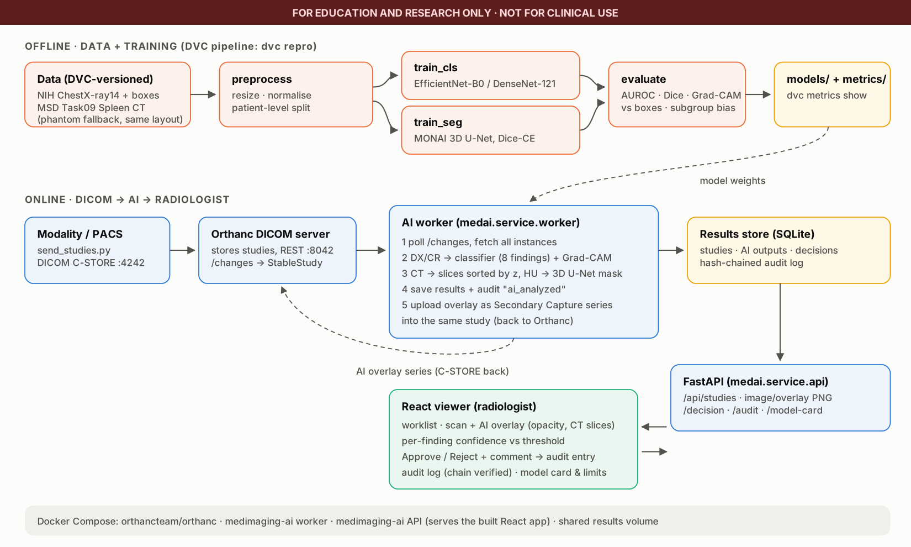

# AI-Assisted Medical Imaging and Diagnosis System

> ⚠️ **FOR EDUCATION AND RESEARCH ONLY: NOT FOR CLINICAL USE.** Not a medical device. Outputs must never be used for diagnosis or treatment.

Scans arrive in an **Orthanc DICOM server**. A worker pulls each new study and runs deep-learning models:
- **Chest X-ray:** 8-finding classifier with a **Grad-CAM** heat map per finding.
- **Abdominal CT:** **MONAI 3D U-Net** spleen segmentation.

It stores the results and pushes the AI overlay back to Orthanc. A **React viewer** shows the scan, overlay, confidence and **Approve / Reject** buttons, and every decision lands in a **tamper-evident audit log**.

**Stack:** MONAI · PyTorch · Orthanc · Grad-CAM · DVC · Docker · React · FastAPI · pydicom/pynetdicom
**Track:** AI / Machine Learning



| Milestone | Where |
|---|---|
| 1. Public data (NIH ChestX-ray14, MSD Task09 Spleen), DICOM format | `src/medai/data/`, [docs/DICOM.md](docs/DICOM.md), `scripts/dicom_inspect.py` |
| 2. Resize, normalise, augment; data versioned with **DVC** | `preprocess.py`, `train_cls.py` (augment), `data/raw.dvc`, `dvc.yaml` |
| 3. Transfer-learning classifier (EfficientNet-B0 / DenseNet-121) + **3D U-Net (MONAI)** | `train_cls.py`, `train_seg.py`, `models.py` |
| 4. **Grad-CAM** per prediction, scored against radiologist boxes | `explain.py`, `evaluate.py` |
| 5. **Orthanc** + service that pulls new studies, runs inference, stores results | `service/worker.py`, `service/orthanc.py`, `service/db.py` |
| 6. **React** viewer: scan, AI overlay, confidence, Approve/Reject, **audit log** | `web/`, `service/api.py` |
| 7. **Docker**, model limits & bias, education-only notice | `docker/`, `docker-compose.yml`, [docs/MODEL_CARD.md](docs/MODEL_CARD.md) |

**Further docs:** [Report](docs/REPORT.md) (problem, design, challenges, results, next steps) · [Architecture & data](docs/ARCHITECTURE.md) · [API](docs/API.md) · [Model card, limits & bias](docs/MODEL_CARD.md)

---

## 1. Setup (once)

Requires Python 3.11–3.13, Node 18+ and about 6 GB disk. A GPU isn't needed.

```bash
unzip medimaging-ai.zip && cd medimaging-ai
python3.11 -m venv .venv && source .venv/bin/activate          # Windows: .venv\Scripts\activate
pip install torch torchvision --index-url https://download.pytorch.org/whl/cpu
pip install -r requirements.txt
cd web && npm ci && npm run build && cd ..
```

Install Orthanc, either natively or with Docker:
- **Ubuntu/Debian:** `sudo apt install orthanc`
- **macOS:** `brew install orthanc`
- **Windows:** the installer from orthanc.uclouvain.be
- **Docker:** `make orthanc` uses `orthancteam/orthanc` automatically if Orthanc isn't installed.

All commands below run from the project root with the venv active. Each `make` target shows the plain command it runs, for Windows without make:

```bash
export PYTHONPATH=src          # PowerShell: $env:PYTHONPATH="src"
```

## 2. Data

| Task | Dataset (chosen) | Why |
|---|---|---|
| Classification | **NIH ChestX-ray14**: 112,120 frontal radiographs, 30,805 patients, 14 labels, **984 radiologist bounding boxes** | Open download without credentialing (unlike MIMIC-CXR and CheXpert). Its boxes let Grad-CAM be scored, not just shown. Patient IDs allow leak-free splits |
| Segmentation | **Medical Segmentation Decathlon Task09 Spleen**: 41 portal-venous CT volumes with labels | MONAI's reference 3D task, small enough to train on a laptop |

**Option A: real data (recommended).**
- **NIH via Kaggle:** `kaggle.com` → Settings → API → *Create New Token* → save `~/.kaggle/kaggle.json`.
- **MSD:** downloads from MONAI's public mirror, no account needed.

```bash
make download              # = bash scripts/download_data.sh         (NIH 5.6k-image sample + MSD spleen, ~3.5 GB)
bash scripts/download_data.sh full                                     # full NIH, 112k images, 45 GB
make data                  # = python -m medai.acquire && dvc add data/raw     (versions the raw data)
```

If Kaggle is blocked, download in a browser instead:
- **NIH:** https://www.kaggle.com/datasets/nih-chest-xrays/sample (or `/data` for the full set), or the original NIH Box link on https://nihcc.app.box.com/v/ChestXray-NIHCC. Unzip everything into `data/raw/downloads/`, then run:
  ```bash
  python -c "from medai.data.nih import import_kaggle; import_kaggle('data/raw/downloads','data/raw/nih-cxr14')"
  ```
- **MSD:** download `Task09_Spleen.tar` from http://medicaldecathlon.com and extract it to `data/raw/Task09_Spleen/`.

**Option B: no download (runs anywhere).** `make data` without real files renders **phantoms** in the exact NIH and MSD layouts:
- **Chest X-rays:** one radiograph per *real* NIH metadata row (real labels, patients, age, sex, view). Findings are drawn at the **real radiologist box locations**, and lung shapes come from 500+ **real expert lung masks**.
- **CT:** abdominal phantoms in Hounsfield units.

All results in `docs/` come from Option B, because the build environment couldn't reach Kaggle or the NIH download hosts.

## 3. Train and evaluate (DVC pipeline)

```bash
make train                 # = dvc repro      preprocess → train_cls → calibrate → train_seg → evaluate
make metrics               # = dvc metrics show
```

- Only stages whose code, data or `params.yaml` changed re-run. Try changing `classification.epochs` and run `dvc repro` again.
- Takes about 35 min on a 2-core CPU.
- With internet access, ImageNet weights download automatically (`classification.pretrained: imagenet`). Without it, training falls back to random initialisation and logs a warning.
- Outputs:
  - `models/` (classifier, thresholds, 3D U-Net)
  - `metrics/*.json`
  - `docs/figures/roc_per_finding.png`
  - `docs/figures/gradcam_examples.png`

## 4. Run the platform

Use three terminals:

```bash
make orthanc               # Orthanc: web UI http://localhost:8042, DICOM port 4242
make serve                 # API + viewer + worker: http://localhost:8000   (API docs: /docs)
make send                  # act as a scanner: DICOM C-STORE 12 chest X-rays + 2 CTs to Orthanc
```

Open **http://localhost:8000**:
1. New studies appear in the worklist within seconds.
2. Click one to see the scan with the AI overlay. Click a finding to switch its Grad-CAM; for CT, scroll slices.
3. Enter your name, optionally tick findings you disagree with, and press **Approve** or **Reject**.
4. **Audit log** shows every event with chain verification. **Model card & limits** shows metrics and the bias audit.

The AI overlay is also stored in Orthanc as a new series of the study: check http://localhost:8042.

### Docker

```bash
make train                 # models are baked into the image
make up                    # = docker compose up -d --build     (Orthanc + worker + API/viewer)
make send                  # send studies to localhost:4242
```

## 5. Tests

```bash
make test                  # = python -m pytest -q      (11 tests; the end-to-end test needs Orthanc running)
```

The tests cover:
- real NIH metadata
- phantoms placed at the real box locations
- patient-level split, no leakage
- DICOM round-trips: HU and geometry preserved, train/serve pixel parity
- model quality gates
- the Grad-CAM localisation metric
- audit-chain tamper detection
- **end to end against a live Orthanc**: DICOM in → worker → overlay series in Orthanc → API → decision → verified audit

## Project layout

```
params.yaml  dvc.yaml  data/raw.dvc       configuration · pipeline · versioned raw data
src/medai/
  data/nih.py  data/msd.py                NIH ChestX-ray14 + MSD Spleen loaders, phantom renderers
  data/dicom_io.py                        DICOM writers/readers (DX, CT series, Secondary Capture)
  acquire.py  preprocess.py               data/raw → data/processed
  models.py  train_cls.py  train_seg.py   classifier (transfer learning) and 3D U-Net
  calibrate.py  explain.py  evaluate.py   thresholds on validation · Grad-CAM · test metrics + bias audit
  inference.py                            Predictor used by the service
  service/orthanc.py worker.py db.py api.py   Orthanc client · study worker · results + audit · REST API
web/                                       React viewer (Vite)
scripts/                                   send_studies.py (C-STORE) · download_data.sh · run_orthanc.sh · dicom_inspect.py
docker/  docker-compose.yml  orthanc/      containers + Orthanc config
docs/                                      REPORT · ARCHITECTURE · API · MODEL_CARD · DICOM · figures
tests/                                     pytest suite
```
