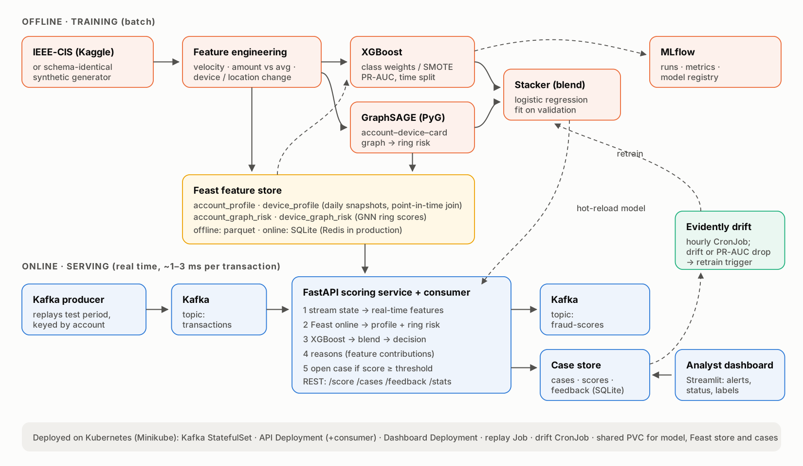
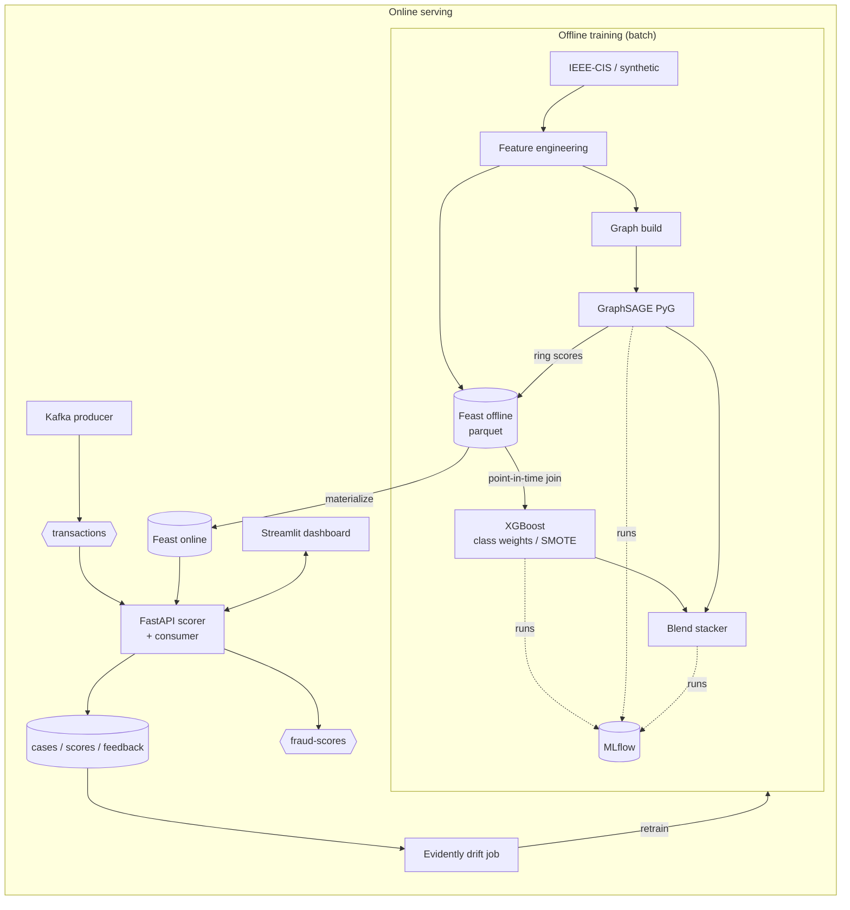

# Architecture & data documentation

## Data flow for one transaction (online)

1. **Ingest.** The producer publishes the raw IEEE-CIS record to the `transactions` topic, keyed by `card1_addr1`. All events of one account go to the same partition, so they reach the same consumer replica.
2. **Canonicalize.** `canonical_record()` derives the entity keys:
   * `uid` (account) = card1 + addr1 + (day − D1): the account-start day, i.e. the well-known IEEE-CIS client key
   * `card_id` = card1/card2/card5/card6
   * `device_id` = DeviceInfo | browser (id_31) | screen (id_33)
3. **Real-time features.** `OnlineFeatureEngine` computes them from in-memory state that only contains *previous* events. It was warm-started from history at startup.
4. **Profile features.** One Feast `get_online_features` call returns `account_profile`, `device_profile`, `account_graph_risk` and `device_graph_risk`.
5. **Model.** XGBoost (`inplace_predict`) gives `p_xgb`. The blend is `σ(b + Σ wᵢ·logit(sᵢ))` over `p_xgb`, the account ring score, and the device ring mean/max. Decision: `REVIEW` if score ≥ threshold, else `APPROVE`.
6. **Explain.** For alerts, XGBoost `pred_contribs` (TreeSHAP) gives the top-3 reasons; GNN ring flags are added when > 0.5.
7. **Persist.** The service writes the score and feature vector (used for drift), opens a case for alerts, and publishes the result to `fraud-scores`. The Kafka offset is committed only after publishing (at-least-once delivery).

## Features (51 model inputs)

| Group | Features | Store | Computed from |
|---|---|---|---|
| Velocity | `uid_cnt_1h`, `uid_cnt_24h`, `uid_cnt_7d`, `uid_amt_sum_24h`, `uid_secs_since_last`, `dev_cnt_24h` | stream state | prior events only |
| Amount vs. user's average | `amt_to_acct_mean`, `amt_zscore`, `amt_to_dev_mean`, `log_amount`, `amt_cents` | derived from Feast profile | profile as of the previous day end |
| Device change | `dev_new_for_uid`, `dev_changed`, `dev_prior_uids` | stream state | prior events |
| Location change | `card_addr_changed`, `card_prior_addrs`, `dist1` | stream state / raw | prior events |
| Identity change / sharing | `email_changed`, `card_prior_uids`, `uid_prior_cnt` | stream state | prior events |
| Account profile | `acct_txn_count`, `acct_amt_mean`, `acct_amt_std`, `acct_n_devices`, `acct_night_ratio`, `acct_active_days` | **Feast** `account_profile` | daily snapshots |
| Device profile | `dev_n_accounts`, `dev_txn_count`, `dev_amt_mean` | **Feast** `device_profile` | daily snapshots |
| Time | `hour`, `dow` | derived | — |
| Raw IEEE-CIS | C1, C2, C5, C6, C9, C11, C13, C14, D1, D2, D3, D4, D10, D11, D15 | request | — |
| Categorical | product, card4, card6, device_type, p_email | request | encoder fitted on train |
| Graph (blend only) | `gnn_score`, `gnn_dev_mean`, `gnn_dev_max` | **Feast** `*_graph_risk` | GraphSAGE |

**Training/serving parity is enforced by construction and by tests.** Each feature has one batch implementation (vectorized pandas, used for training) and one streaming implementation (per-event, used for serving). `tests/test_features.py` replays 8,000 events through both and asserts the values match exactly. The same holds for `to_canonical` vs `canonical_record` and `assemble` vs `assemble_record`.

**No future leakage.**
* Real-time features count only events before the current one.
* A Feast profile snapshot for day *d* carries `event_timestamp` = end of day *d*, so a transaction only ever joins completed days.
* The GNN is trained on labels from the training period only.
* Splits are chronological: 70% train, 15% validation, 15% test by TransactionDT.

## Feast feature views

| View | Entity (join key) | Features | Freshness |
|---|---|---|---|
| `account_profile` | account (`uid`) | 6 | daily |
| `device_profile` | device (`device_id`) | 3 | daily |
| `account_graph_risk` | account (`uid`) | `gnn_score` | per training run |
| `device_graph_risk` | device (`device_id`) | `gnn_dev_mean`, `gnn_dev_max` | per training run |

Offline store: parquet files in `data/processed/feast/`. Online store: SQLite (switch to Redis in `feature_repo/feature_store.yaml` for production).

## Graph

* **Nodes:** accounts, devices, cards.
* **Edges:** account–device and account–card. Only entities that link ≥ 2 accounts are kept, and hubs used by > 200 accounts are dropped because they carry no ring signal.
* **Account node features:** behavioral aggregates. **Entity node features:** degree and transaction volume.
* **Model:** 2-layer GraphSAGE trained with the **label trick**. Known labels are input features for a random half of the labelled accounts each epoch, and the loss is computed on the other half. This teaches guilt-by-association without ever seeing the predicted node's own label.

## Storage written by the API

SQLite tables (WAL mode; plain SQL, so Postgres is a drop-in replacement):

* `cases(transaction_id PK, uid, device_id, amount, ts, fraud_score, xgb_score, gnn_score, reasons JSON, status open|investigating|closed, label fraud|legit, analyst, note, created_at, updated_at)`
* `scores(transaction_id PK, ts, fraud_score, decision, features JSON, scored_at)`: the drift monitor's input
* `feedback(transaction_id PK, label 0|1, source analyst|chargeback, created_at)`: live PR-AUC and retraining labels

## Kafka topics

| Topic | Key | Value |
|---|---|---|
| `transactions` | `card1_addr1` | raw IEEE-CIS transaction JSON (same schema as `POST /score`) |
| `fraud-scores` | `uid` | the `POST /score` response JSON |

## Deployment (k8s/)

| Manifest | Contents |
|---|---|
| `00-namespace-storage.yaml` | namespace `fraud`, PVC `fraud-state`, ConfigMap |
| `10-kafka.yaml` | single-broker KRaft Kafka StatefulSet + Service |
| `20-api.yaml` | API + consumer Deployment. An initContainer seeds the PVC; readiness/liveness probes on `/health`; Prometheus annotations; NodePort 30800 |
| `30-dashboard.yaml` | Streamlit Deployment, NodePort 30851 |
| `40-jobs.yaml` | replay producer (manual CronJob template), hourly drift-monitor CronJob with `--auto-retrain` |

**Scaling.** Stream state is per account and the topic is keyed by account, so you scale by adding partitions and API replicas (one replica per partition). Moving stream state to Redis would allow arbitrary replicas.
