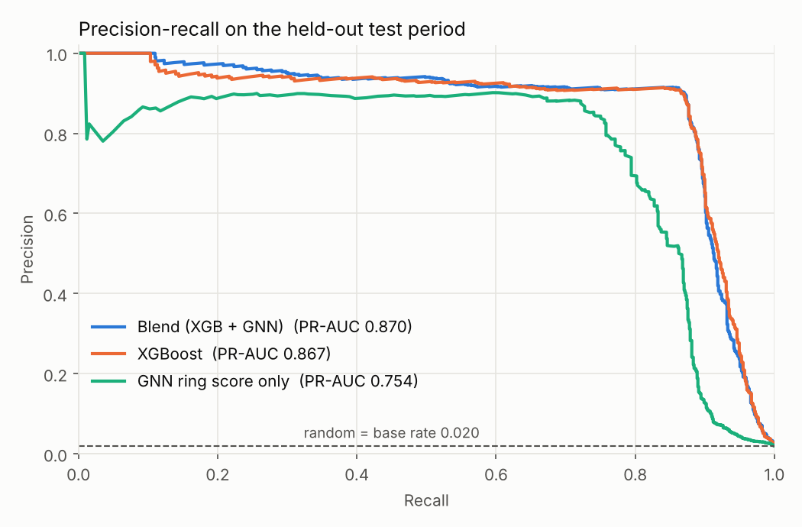
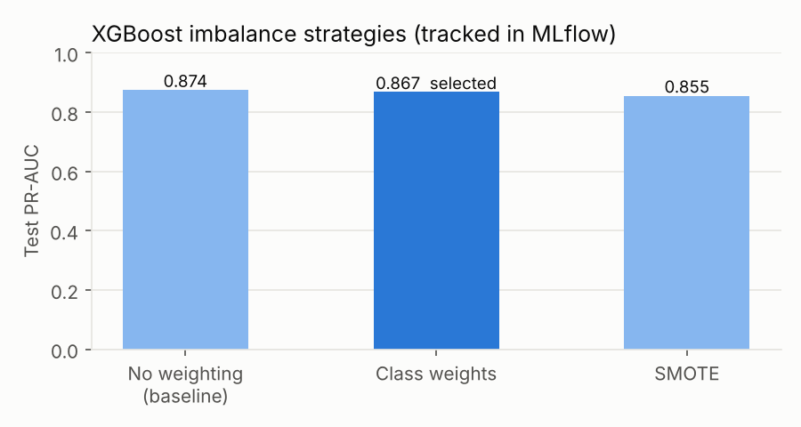

# Project report: Real-Time Financial Fraud Detection Platform

## 1. Problem

Card-not-present fraud has to be stopped **while the transaction is in flight**. That imposes four constraints:

* **Latency.** A decision is needed in milliseconds, using features that describe the account's behavior *up to this moment*.
* **Extreme imbalance.** A few percent of transactions (often < 1%) are fraud, so accuracy is meaningless: "never fraud" is > 96% accurate. Precision-recall is what matters, because every alert costs analyst time.
* **Organized fraud.** Rings of mule accounts share devices and stolen cards. Each account can look unremarkable alone; the pattern only shows in the relationships between them.
* **Change over time.** Fraudsters adapt, so the system must detect drift and retrain itself.

## 2. Dataset choice

| Option | Entity columns for a graph | Time axis | Verdict |
|---|---|---|---|
| **IEEE-CIS (Vesta)** | card1–6, addr, e-mail, DeviceInfo, browser, screen | yes (TransactionDT) | **chosen**: the only option that supports every milestone on one dataset |
| PaySim | origin/destination account only | step (hours) | synthetic; no device or card entities |
| ULB credit card | none (PCA features V1–V28) | seconds | no entities, so no graph |
| BAF (NeurIPS 2022) | none linkable | month | tabular only |
| Elliptic | transaction graph | time step | crypto; no card or device context for the XGBoost part |

**Fallback.** Kaggle was not reachable from the build sandbox, so the project ships a generator that writes the
*same IEEE-CIS columns*. It injects three fraud mechanisms:
* **Fraud rings.** Mule accounts share small pools of devices and stolen card BINs, and half of them rotate their own devices.
* **Account takeovers** coming from ring devices.
* **Opportunistic, low-signal fraud.**

It also adds legitimate noise: families sharing a device, travel, and large one-off purchases. **All numbers below come from the generator (302,956 transactions).** The IEEE-CIS loading path was verified end to end by exporting generated data in the exact `train_transaction.csv` + `train_identity.csv` layout (30% identity coverage, like the real data) and running `--source ieee`.

## 3. EDA (`data/processed/eda.json`)

| | |
|---|---|
| Transactions / days | 302,956 / 182 |
| Accounts / devices / cards | 12,692 / 23,162 / 9,867 |
| Fraud rate | **3.99% (1 : 24)**. IEEE-CIS is 3.5% (1 : 28); PaySim and ULB are 0.13–0.17% |
| Fraud rate by split (chronological) | train 4.58% · valid 3.22% · test **2.00%**: the base rate itself drifts |
| Median amount legit vs. fraud | $46 vs. $133 |
| Fraud rate by product | C 21.1% · W 2.5% · H/R/S < 1% |
| Fraud rate at night (00–06h) vs. day | 62% vs. 1.4% |

The brief says "under 1% fraud", which describes PaySim/ULB. The chosen dataset is about 3.5–4%, still heavily imbalanced. Everything here is built for that regime: class weighting or SMOTE, PR-AUC as the metric, and a threshold set by target precision. Nothing assumes a particular base rate.

## 4. Design

**Features.** There are two families, each with exactly one definition (full table in [ARCHITECTURE.md](ARCHITECTURE.md)):

* **Real-time stream features** use only events *before* the current one:
  * velocity: 1h/24h/7d counts, 24h spend, seconds since the last transaction
  * device change and new device for the account; number of accounts seen on the device or card
  * location change: billing address differs from the card's previous transaction
  * e-mail change
* **Profile features in Feast:** daily account and device snapshots, joined point-in-time. "Amount vs. the user's average" is the transaction amount divided by the Feast account mean as of the previous day end. Training uses `get_historical_features`; serving reads the same views online.

**XGBoost.** Three runs are tracked in MLflow: no weighting (reference baseline), class weights (`scale_pos_weight = sqrt(neg/pos)`), and SMOTE (minority raised to 25% of the majority). The better of class weights and SMOTE on *validation* PR-AUC is shipped. The test set is touched only for reporting.

**GNN.**
* **Graph:** accounts linked to the devices and cards they use. Hubs used by more than 200 accounts are removed.
* **Model:** 2-layer GraphSAGE (PyTorch Geometric), trained on labels from the training period only, using the *label trick* so guilt-by-association is learnt without label leakage.
* **Outputs:** an account ring score, plus a device ring score (mean and max of the account scores seen on that device). The device score catches account takeovers, where the account is clean but the device is "hot". Both are published to Feast.

**Blend.** A logistic-regression stacker is fitted on the validation period over the logits of the XGBoost, account ring and device ring scores. A guard drops the GNN weight to zero if the blend is not better on validation. The alert threshold is set on validation for 80% precision.

**Serving.** One `Scorer` class is shared by the HTTP API and the Kafka consumer:
* a pure-Python fast path (no pandas per request)
* a single Feast online call per transaction
* XGBoost `inplace_predict`
* TreeSHAP reasons computed only for alerts

**Monitoring.**
* Evidently `DataDriftPreset` compares recent scored traffic with the most recent labelled window (validation period).
* Cumulative counters (account age, prior-transaction counts, "days since" fields) are excluded, because they grow by construction and would fire forever.
* **Retraining fires** if more than 30% of monitored features drift, if amount behavior (`log_amount`, `amt_to_acct_mean`) drifts on its own, or if live PR-AUC on feedback labels falls more than 0.10 below the offline baseline.
* The retrained model is hot-reloaded by the API without downtime, and the stream state is carried over.

## 5. Results (held-out test period: last 15% of the timeline, 45,444 transactions)

| Model | PR-AUC | ROC-AUC | Recall @ 80% precision | Precision in top 1% |
|---|---|---|---|---|
| Random (base rate) | 0.020 | 0.500 | — | 0.020 |
| GNN ring score only (no transaction features) | 0.754 | 0.951 | 0.758 | 0.894 |
| XGBoost (class weights, shipped) | 0.867 | 0.984 | 0.887 | 0.932 |
| **Blend XGBoost + GNN (shipped)** | **0.871** | **0.984** | **0.887** | **0.938** |

* **Operating point.** The threshold 0.054 was chosen on validation. On test it raises **928 alerts (2.04% of traffic) at 85.9% precision and 87.7% recall**, so about 6 of 7 alerts are real fraud.
* **Blend lift** is consistent on both splits:
  * validation PR-AUC: 0.856 → 0.862
  * test PR-AUC: 0.867 → 0.871
  * accounts never seen in training: 0.9215 → 0.9224
* **Graph:** 12,692 accounts, 3,184 linking device/card nodes, 9,538 edges. GNN account-level validation PR-AUC is 0.714.

| XGBoost variant | valid PR-AUC | test PR-AUC |
|---|---|---|
| no weighting (baseline) | 0.861 | 0.874 |
| class weights √(neg/pos) (selected) | 0.856 | 0.867 |
| SMOTE 25% | 0.846 | 0.855 |

**Serving performance** (`make bench`, 1 CPU core, Feast SQLite online store):

| | p50 | p95 | p99 |
|---|---|---|---|
| In-process scoring (features + Feast + model + blend) | 1.10 ms | 1.63 ms | 2.83 ms |
| HTTP end to end (FastAPI, localhost) | 3.6 ms | 4.6 ms | 5.9 ms |

Throughput is about 826 transactions/s per core.

**Live replay** of 6,000 test-period transactions through the API, with chargeback labels:
* PR-AUC 0.856, matching offline
* 254 cases opened
* p95 latency 2.46 ms

**Drift.**
* Live traffic: 12% of features drifted, no retrain.
* Test split vs. validation: 4%, no retrain.
* Test split with an injected 3× amount shift: retrain triggered. The full pipeline re-ran automatically and the running API hot-swapped to the new model version.

**Tests:** 18/18 pass (`make test`): feature parity, leakage, Feast parity, quality gates, API contract/latency, Kafka loop, drift.

### What was verified where

| Component | Verified in the build environment | Notes |
|---|---|---|
| Training pipeline, Feast, MLflow, GNN, blend | ✅ ran end to end | synthetic data and IEEE-format CSV path |
| FastAPI + dashboard + drift + auto-retrain + hot reload | ✅ ran live | dashboard checked with Streamlit's headless test runner |
| Kafka consumer/producer logic | ✅ via in-memory Kafka stand-in (test) | no Kafka broker available in the sandbox |
| Docker Compose / Minikube | ⚠️ manifests written, not executed | no Docker daemon in the sandbox; run `make up` / `make k8s` |
| Real IEEE-CIS numbers | ⚠️ not run (Kaggle blocked) | run `make data && make train` |

## 6. Challenges and how they were handled

1. **Training/serving skew.** Velocity features computed in pandas for training and in a stream for serving drift apart easily. Fix: twin implementations plus an exact-equality test over 8,000 events. The Feast point-in-time join was also cross-checked against an independent implementation.
2. **Label and time leakage.** Random splits and "future" profile values inflate offline scores. Fix: chronological splits, end-of-day snapshot timestamps, strictly-prior real-time features, and GNN labels from the training period only.
3. **The GNN initially *hurt* the blend** (0.870 → 0.862). The analysis showed two causes:
   * XGBoost's first-order relational features (`dev_prior_uids`, `card_prior_uids`) already captured device-sharing rings.
   * An account-level score is constant across a takeover victim's legitimate and fraudulent transactions.

   Fixes: the label trick for guilt-by-association, a device-level ring score, and a validation guard on the blend. The GNN now adds a small but consistent lift.
4. **Imbalance handling did not beat no weighting on PR-AUC.** PR-AUC is a ranking metric, and reweighting mainly shifts calibration. Full inverse-frequency weights hurt more than √ weights, and SMOTE interpolates between fraud points from different rings, which blurs the boundary. The brief requires class weights or SMOTE, so the better of those two is shipped and the unweighted run is kept in MLflow as the reference.
5. **False drift alarms.** Cumulative counters drift by construction and fired retraining on every run (54% of features drifted on healthy traffic). They are now excluded, and the reference is the most recent window. Healthy traffic sits at 4–13% and the 3× shift still triggers.
6. **Latency.** The first version built pandas DataFrames per request (p50 26 ms). A pure-Python fast path, one Feast call and `inplace_predict` brought it to 1.1 ms. Parity with the batch path is test-enforced.

## 7. Next steps

* **Run on real IEEE-CIS.** Expect clearly lower absolute PR-AUC than on the synthetic data, because real fraud is noisier. Bring in the extra V-columns via feature selection.
* **Label delay.** Chargebacks arrive weeks later. Train with label-maturity windows, and use analyst labels for early drift signals.
* **Inductive GNN scoring.** Score new accounts within minutes (neighbor sampling over a streaming graph store) instead of at retrain time.
* **Shared stream state in Redis** (or Flink / Feast push sources) so API replicas scale beyond the number of partitions.
* **Cost-sensitive threshold** set by expected loss (amount × p) against analyst capacity, instead of fixed precision.
* **Champion/challenger rollout** with shadow scoring before a retrained model is promoted from the MLflow registry.
